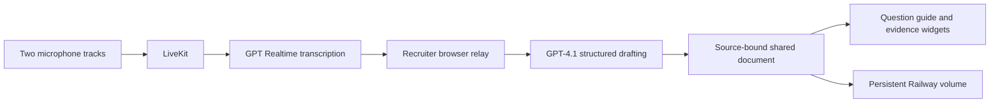

# Interview studio: Mac mini and iPad Safari QA

## Goal

Test the hosted interview studio in Safari on an iPad Simulator on the user's Mac mini. Record a short, actual interaction and report observed failures. Make targeted fixes on this QA branch if necessary.

The user authorized using the Mac mini and starting a separate Codex chat for this work. This handoff does not mean a Mac chat has started or a Simulator test has passed.

## Source and deployment

- Repository: https://github.com/human-bee/PRESENT
- QA branch: `codex/interview-studio-ipad-qa-20261019`
- Deployed app branch: `codex/interview-studio-live-20261018`
- Tested app commit: `1cfde40a7f8ba13bb36992fea5878378d0d67f66`
- Hosted origin: https://interview-studio-web-production.up.railway.app
- The QA branch contains the deployed code plus this handoff and the capture helper.
- The deployed app branch automatically redeploys the isolated Railway web and listener services. Commit QA fixes here first; a branch push here does not update the live app.
- The root Dockerfile on these interview branches builds the isolated studio. Do not merge it over the main application's deployment setup as incidental QA work.

Read local `AGENTS.md` instructions. Find the actual Mac repository path; cloud paths under `/workspace` are not Mac paths. Preserve existing work and use a separate worktree when the local repository is dirty. Fetch this branch from origin rather than relying on the Mac's existing branch.

## Private test room

Use the synthetic QA invitation supplied privately with the Mac chat prompt. Its room ID is `4a9fe88f-b28b-4912-97bd-1f7dd16bdd61`. The access fragment is a private document capability and is deliberately absent from this repository.

Keep the separate human-test room (`21f1b3c4-8ab0-4688-8f80-fe036914a573`) clean. Avoid placing private invitations, API credentials, candidate assets, or recordings containing them in this public repository. Hosted-browser testing requires no local OpenAI or LiveKit secret configuration.

Opening the completed synthetic room inspects saved results. It does not reproduce the live voice test or establish speech-to-render latency.

## Simulator procedure

1. Verify this executor is macOS; inspect `xcode-select -p`, `xcodebuild -version`, and `xcrun simctl list devices available`.
2. Select an explicit available iPad Simulator UDID. Keep all boot, open, screenshot, recording, and cleanup commands scoped to that device. Do not change the user's Xcode project or global developer-directory selection for this web test.
3. Open the private QA invitation directly in the Simulator's Safari. Verify the actual PRESENT interview page is visible. A launched URL or HTTP 200 alone is insufficient.
4. Inspect the screen before each interaction with available Simulator UI tools. If the iOS Simulator browser skill is available, follow it for mirroring and cleanup. Do not claim an automated interaction occurred if no UI control tool is available.
5. Capture real Simulator screenshots and a short video. The optional helper lists iPads with `bash scripts/interview-studio/test-ipad-simulator.command --list`. Run it again with the selected UDID, then paste the private QA URL at its silent prompt. It records 20 seconds after an operator confirms the page is visible. It is an interactive capture helper, not an assertion suite.
6. Save evidence outside the Git worktree, or in an ignored local artifact directory. Inspect the resulting frames before reporting a pass.

The helper has passed Bash syntax validation and its non-macOS guard was exercised in Linux. It has not yet been executed on macOS.

## Checks to perform

| Flow | Expected evidence |
| --- | --- |
| Launch | Correct synthetic profile, no blank page or framework error overlay |
| Meet | Two participant slots; connect/mic/camera controls and note consent visible; readable first viewport |
| Scenes | Meet, Brief, and Canvas each open and remain usable with touch |
| Brief | Prepared prompts, empty answer cues where applicable, saved work facts, and latest-change widget are readable |
| Editing | Focus one answer, enter a marked synthetic QA note, dismiss the keyboard, and reload; the note persists |
| Shared state | If a second independent browser joins the same synthetic room, scene changes and edits appear in both |
| Materials | Add a harmless example.com portfolio link and inspect its placement on Canvas and in the document |
| Source inspection | Inspect one saved candidate claim through its evidence interaction; source details remain discoverable |
| Session inspector | Open the pipeline view; distinguish saved traces from a new live update |
| Layout | Check portrait and landscape, keyboard overlap, scroll access, control hit targets, and horizontal overflow |
| Audio | Exercise connect and the user-gesture sound control; record actual permission or unsupported-media behavior |
| Recovery | Reload or reconnect and verify document state remains present |

Use synthetic text only. Mark manual QA notes clearly. Do not run the production smoke harness or reseed rooms merely to inspect Safari.

A Simulator check can establish Safari layout and interaction behavior. Camera, microphone, speaker routing, backgrounding, and an actual two-person call still need physical-device verification. Record unsupported simulator media as an untested hardware check.

## Existing verification

The hosted two-voice test passed on 2026-10-18:

- OpenAI `gpt-4o-mini-tts`: marin for the recruiter and cedar for the candidate.
- Two actual LiveKit participants published separate audio tracks.
- The silent listener used GPT Realtime transcription; the original script was not supplied to it.
- GPT-4.1 generated and saved three candidate additions through the same note and drafting APIs used by the browser.
- Team size eight, deployment time 18 to 3 minutes, and the human-approval caveat were retained.
- Recruiter questions did not become candidate work.
- Model decision plus durable save: 1024 ms, 921 ms, and 1310 ms.
- The media harness did not measure browser rendering or physical-device latency.
- 34 backend tests passed. Production Chromium interaction covered two isolated sessions, shared edits, reload persistence, and desktop/tablet/phone layouts.

The actual live call path is:

During a real pilot, both people must enable shared note drafting; keep the recruiter browser open and in the foreground so it relays live transcription.

## Deliverable

Return the exact Xcode/runtime/device used, observed pass/fail/untested checks, a playable Simulator recording, and readable screenshots. Describe and verify any fixes. Keep simulator evidence, headless-media evidence, and physical-device results distinct. Do not label saved QA traces as a newly measured live update.
